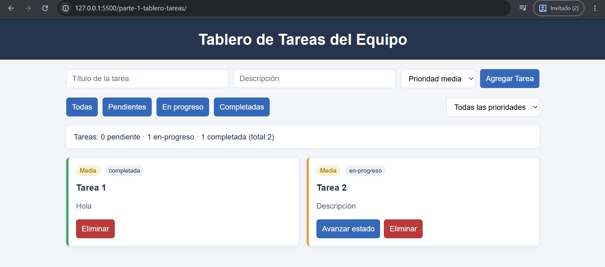
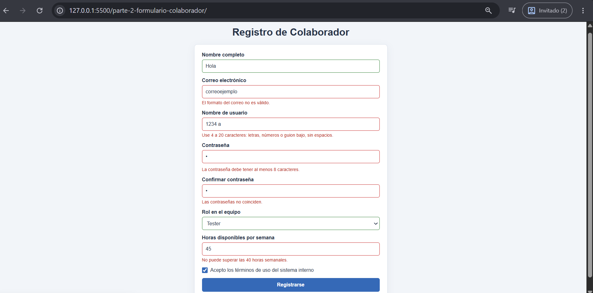
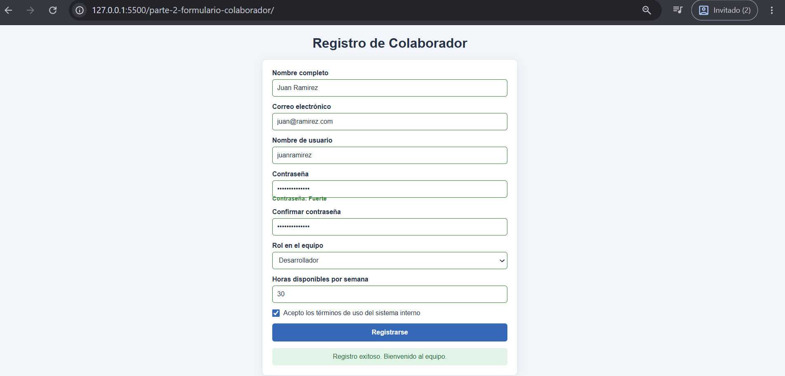

# Post-contenido — Unidad 4: JavaScript Básico

## Descripción
Repositorio del laboratorio de la Unidad 4 de Programación Web —
Séptimo Semestre. Contiene dos partes: tablero de tareas del equipo
con manipulación del DOM y eventos (parte-1-tablero-tareas/) y
formulario de registro de colaborador con validación manual y
Constraint Validation API (parte-2-formulario-colaborador/).

## Parte 1 — Tablero de tareas del equipo
Tablero de tareas en JavaScript puro que implementa creación,
avance de estado y eliminación (con un único listener delegado que
distingue acciones por data-action), filtrado combinado por estado
y prioridad, un switch para la apariencia por prioridad, y
estadísticas calculadas con reduce() y for...of. Ver
parte-1-tablero-tareas/. Se añadió un styles.css sencillo para esta parte,
ya que la guía no incluía una hoja de estilos.

## Parte 2 — Formulario de registro de colaborador
Formulario de registro con validación completa del lado del
cliente: campo de usuario validado con pattern, campo condicional
"equipo a cargo" que solo aplica al rol Líder, campo numérico de
horas validado con rangeUnderflow/rangeOverflow, checkbox de
términos validado por .checked, control del evento submit y un
indicador de fortaleza de contraseña. Ver
parte-2-formulario-colaborador/. Se añadió un styles.css sencillo para esta
parte, ya que la guía no incluía una hoja de estilos.

## Decisiones de diseño

### Parte 1 — Generador de ID
Se eligió la Estrategia A (closure). El contador queda encapsulado
dentro de crearGeneradorId() y solo se puede incrementar mediante
generarId(). Aunque la estrategia B es más simple de leer al inicio,
la closure evita que otras partes del archivo modifiquen el contador
accidentalmente.

### Parte 1 — Actualización del DOM al avanzar estado
Se eligió la Estrategia B (reconstrucción completa). renderizarTablero()
crea las tarjetas desde el array tareas y aplica los filtros activos.
Agregar tareas y eliminarlas también llaman a esa función, para mantener
una única forma coherente de actualizar el DOM y evitar que difiera del
estado de los datos.

### Parte 2 — Validación de contraseña
Se eligió la Estrategia B (validaciones independientes). Cada regla se
comprueba por separado y muestra un mensaje específico cuando falla.
Esto permite saber qué requisito falta, a diferencia de la Estrategia A,
que usa una regex compuesta y solo puede mostrar un mensaje genérico.

### Parte 2 — Campo condicional "equipo a cargo"
Se eligió la Estrategia A (alternar required nativo). El atributo required
se activa cuando el rol es Líder y se desactiva para los demás roles.
Así, la Constraint Validation API refleja automáticamente si el campo
es obligatorio y se evita duplicar esa condición en una validación manual.

## Cómo visualizar el proyecto
1. Clonar el repositorio: `git clone [URL-del-repo]`
2. Abrir la carpeta en Visual Studio Code
3. Clic derecho en index.html (de cada parte) → "Open with Live Server"

## Capturas de pantalla

